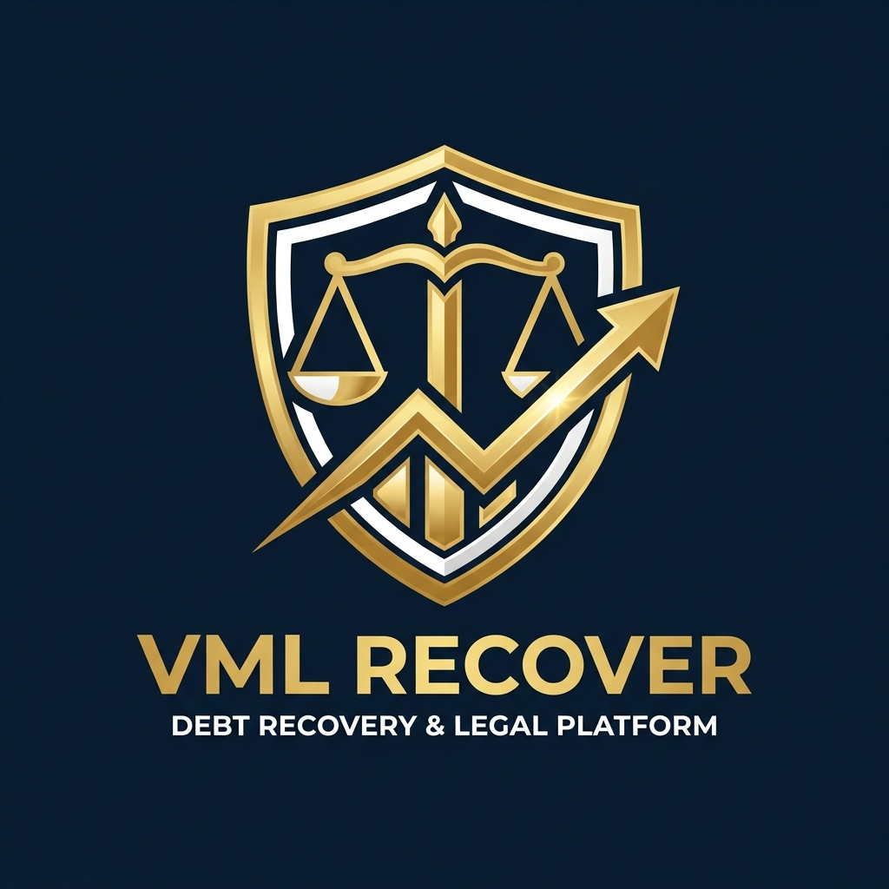

# VML RECOVER — Brand Identity & Executive Theme System

## 1. Brand Essence: Legal Authority & Debt Recovery Excellence
**VML Recover** is a corporate loan recovery and debt collection platform built with a signature **Executive Midnight Navy and Metallic Gold** design language. The brandmark incorporates:
- **The Golden Shield**: Represents institutional trust, legal asset protection, and corporate governance.
- **The Scales of Justice**: Represents regulatory compliance, ethical debt mediation, and legal enforcement.
- **The Upward Financial Trend Arrow**: Denotes accelerated capital recovery, increasing liquidity, and positive settlement outcomes.

---

## 2. Restored Executive Color System

| Token | Hex Value | Role & Usage |
|---|---|---|
| **VmlGold** | `#D4AF37` | **Primary Brand Color**: App bar highlights, primary actions, key metrics, brandmark |
| **VmlGoldLight** | `#F3E5AB` | **Secondary Accent**: Badges, subtitles, card highlights, progress indicators |
| **VmlGoldDark** | `#AA8014` | **Tonal Accent**: Outlines, borders, pressed states, typography accents |
| **VmlNavyBackground** | `#070D1E` | **Application Canvas**: Deep midnight blue background providing high contrast |
| **VmlNavySurface** | `#101B33` | **Card & Container Surface**: Elevated dashboard cards, modal dialogs |
| **VmlNavySurfaceVariant**| `#162544` | **Input & Component Background**: Form containers, dropdown menus, chips |
| **VmlNavyBorder** | `#22355A` | **Dividers & Outlines**: Clean structural separation across panels |
| **VmlTextPrimary** | `#F8FAFC` | **Main Typography**: Headlines, high-emphasis text, financial figures |
| **VmlTextSecondary** | `#B0C0DB` | **Body Typography**: Descriptions, auxiliary metadata, timestamps |
| **VmlGreen** | `#16A34A` | **Recovery Success**: Completed payments, settled cases, verified tokens |
| **VmlRed** | `#DC2626` | **Legal & Risk Alert**: Defaulted loans, account lockout, security triggers |

---

## 3. UI Component Architecture

1. **Top & Navigation Bars**:
   - Deep navy glassmorphism containers (`VmlNavySurface`) with subtle 1dp gold accents (`VmlGold`).
   - High-contrast icons with filled status indicators.

2. **Executive Stat Cards**:
   - Dark navy backgrounds with gold metric typography (`headlineLarge` in `VmlGold`).
   - Contextual trend chips displaying percentage recoveries.

3. **Input Containers**:
   - Generous touch targets with 62–68dp height for optimal legibility.
   - Gold focused borders (`focusedBorderColor = VmlGold`) and soft navy containers.

4. **Branding Artwork & Assets**:
   - Vector-accurate adaptive launcher icons.
   - High-resolution hero banners and embedded brand artwork (`vml_logo.jpg`) synced directly with the official brand insignia.
